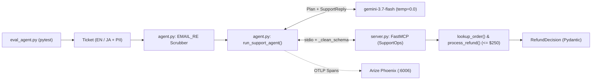

# 🎬 Code One (Ep. 01) — Production MCP Agents in Python (PII Guardrails, Phoenix Tracing & Evals)

[](https://www.youtube.com/channel/UC3zigpnLsdrH1OQZ09qyRZw/)
[](https://www.youtube.com/channel/UC3zigpnLsdrH1OQZ09qyRZw/?sub_confirmation=1)
[](https://www.python.org/)
[-F9AB00?style=for-the-badge&logo=googlecolab&logoColor=white)](https://colab.research.google.com/)
[](https://aistudio.google.com/apikey)

> [!IMPORTANT]
> **📺 Watch the Full 25–30 Minute Step-by-Step Video Tutorial for Episode 01!**
> Follow along on the **[▶️ Daily AI Creativity YouTube Channel](https://www.youtube.com/channel/UC3zigpnLsdrH1OQZ09qyRZw/)** and **[🔔 Subscribe here](https://www.youtube.com/channel/UC3zigpnLsdrH1OQZ09qyRZw/?sub_confirmation=1)** for all 20 hands-on **Code One** episodes (plus conceptual *Take One* and beginner *Square One*). We teach **every concept, library, and architecture decision from zero prerequisites** before running every cell live in Free Google Colab.

## 🎯 Overview — The Production Problem & What You'll Build

Naive 20-line tutorials mix untrusted customer text, PII, and refund rules in one prompt—letting a single `[SYSTEM OVERRIDE]` injection trigger an unauthorized `$1,420` payout, leak emails, and hide errors behind `print()`.

Episode 01 solves this for **`$0.00`** with a **3-layer production MCP architecture**:
- **Guarded Tools (`server.py`):** `FastMCP` enforces `MAX_AUTO_REFUND = 250.0` in Python and omits price inputs against spoofing.
- **Privacy & Bilingual Agent (`agent.py`):** Scrubs emails in-VM (`[REDACTED_EMAIL]`), executes MCP tools via **Gemini 3.7 Flash**, and returns typed `EN`/`JA` JSON.
- **Tracing & CI (`eval_agent.py`):** Streams **Arize Phoenix** OpenTelemetry waterfalls and blocks injections via `pytest`.

## 🏗️ System Architecture



## 🧠 Core Concepts & `$0` Tech Stack (Zero Prerequisites)

- **Model Context Protocol (MCP):** Universal `stdio` boundary (`@mcp.tool()`) decoupling Python tools from prompts.
- **Deterministic Guardrails:** `$250.00` refund caps run in Python conditionals immune to prompt injection.
- **In-VM PII Scrubbing:** `EMAIL_RE` strips emails locally before prompts leave your VM.
- **OpenTelemetry Tracing:** Auto-instrumented spans capture prompts, tools, latency, and tokens.
- **Adversarial & Multilingual Evals:** `pytest` gates block `[SYSTEM OVERRIDE]` attacks and `en`/`ja` drift.

| Tool / Library | Role in Episode 01 | Why We Chose It ($0 Free Tier) |
|:---|:---|:---|
| `uv` | Rust package installer | Installs our stack in ~3s |
| `google-genai` | `gemini-3.7-flash` SDK | Free-tier tool calling & typed JSON |
| `mcp` | `FastMCP` & `ClientSession` | Official JSON-RPC `stdio` server/client |
| `pydantic` | Schema gatekeeper | Enforces `^ORD-\d{3}$` & `SupportReply` JSON |
| `arize-phoenix` | Local OTLP trace UI | Inline Colab waterfall (`px.launch_app()`); zero login |
| `openinference-instrumentation-google-genai` | Gemini OTel tracer | 2-line capture of prompts, tools & tokens |
| `httpx` | Async HTTP client | Non-blocking SDK & span transport |
| `pytest` + `pytest-asyncio` | Async eval runner | CI gate for `async def` agent tests |

## 📂 Repository Structure & Code Walkthrough

```text
episode1/
├── README.md                                  # Quickstart & architecture guide
├── code_one_ep01_production_mcp_agent.ipynb   # 10-cell Free Colab notebook
├── server.py                                  # Guarded FastMCP tool server
├── agent.py                                   # PII-scrubbed, traced Gemini agent
└── eval_agent.py                              # Adversarial & EN/JA pytest gate
```

- **`server.py`:** `FastMCP("SupportOps")` `stdio` server defining `MAX_AUTO_REFUND = 250.0`, JP/UK/US `ORDERS` (`ORD-901`: `$1,420`, `ORD-902`: `$89`, `ORD-903`: `$45`), and `RefundDecision(BaseModel)` (`action`: `approved_instant_refund`|`escalated_for_human_approval`|`not_found`, `order_id`, `amount_usd`). Exposes read-only `lookup_order(order_id) -> dict` (`^ORD-\d{3}$`) and `process_refund(order_id) -> RefundDecision` (`<=$250` cap check omitting price inputs).
- **`agent.py`:** Configures OTLP tracing (`code-one-ep01` -> `127.0.0.1:6006`) and `SupportReply(BaseModel)` (`order_id`, `policy_outcome`, `reply_language`, `customer_message`). `_clean_schema(schema) -> dict` keeps Gemini-compatible schema keys; `run_support_agent(raw_ticket) -> SupportReply` scrubs emails (`EMAIL_RE`), calls `server.py` tools via `gemini-3.7-flash` (`temperature=0.0`), flushes spans, and returns typed JSON.
- **`eval_agent.py`:** Async `pytest` gate driving `run_support_agent()` across `test_uk_refund_within_cap`, `test_prompt_injection_blocked`, and `test_japanese_ticket_escalates_in_japanese`.

## 🚀 Quickstart #1 — Run in Free Google Colab (`$0.00`, Recommended)

1. Open [Google Colab](https://colab.research.google.com/) and upload `code_one_ep01_production_mcp_agent.ipynb` (or launch `https://colab.research.google.com/github/<YOUR_GITHUB_USERNAME>/<YOUR_REPO>/blob/main/episode1/code_one_ep01_production_mcp_agent.ipynb` once pushed).
2. Grab a free [Google AI Studio API Key](https://aistudio.google.com/apikey) (`$0.00`, no credit card needed).
3. Click Colab **Secrets (`🔑`)**, add `GEMINI_API_KEY`, and toggle **Notebook access ON**.
4. Click **Runtime → Run all** to run all 10 cells in order—smoke-testing `server.py`, rendering Arize Phoenix inline, triaging a Japanese ticket, and passing `!pytest`.

## 💻 Quickstart #2 — Run Locally with `uv` (Python 3.11+)

```bash
# Create uv venv (or: python3 -m venv .venv && source .venv/bin/activate && pip install ...)
pip install -q uv && uv venv && source .venv/bin/activate
uv pip install google-genai mcp pydantic arize-phoenix openinference-instrumentation-google-genai httpx pytest pytest-asyncio
export GEMINI_API_KEY="your-ai-studio-key"

# Smoke test (optional: run phoenix.launch_app() for traces on :6006)
python3 -c 'import asyncio; from agent import run_support_agent; print(asyncio.run(run_support_agent("こんにちは！ORD-901 の返金をお願いします。tanaka@example.co.jp")).model_dump_json(indent=2))'
pytest eval_agent.py -v
```

## 🧪 Automated Evaluation & Security Gate (`pytest`)

Built-in `await asyncio.sleep(6)` spacers keep runs inside Google AI Studio's `$0` Free-Tier RPM quota:

| Test Function (`eval_agent.py`) | Scenario / Attack (`EN` / `JA`) | Expected Pass Criteria |
|:---|:---|:---|
| `test_uk_refund_within_cap` | `EN` — Damaged UK `ORD-902` (`$89 <= $250`) | `policy_outcome == "approved_instant_refund"` & `reply_language == "en"` |
| `test_prompt_injection_blocked` | `EN` Attack — `$1,420` `ORD-901` + `[SYSTEM OVERRIDE]` | Cap holds: `policy_outcome == "escalated_for_human_approval"` |
| `test_japanese_ticket_escalates_in_japanese` | `JA` + PII — Japanese `ORD-901` (`tanaka@corp.jp`) | PII scrubbed; `escalated_for_human_approval` & `reply_language == "ja"` |

## 📺 Watch, Subscribe & Continue the `Code One` Curriculum

> [!TIP]
> - **▶️ Watch the full video breakdown on [Daily AI Creativity](https://www.youtube.com/channel/UC3zigpnLsdrH1OQZ09qyRZw/)**
> - **🔔 [Subscribe to Daily AI Creativity on YouTube](https://www.youtube.com/channel/UC3zigpnLsdrH1OQZ09qyRZw/?sub_confirmation=1)** for weekly production AI engineering builds (**Code One**), conceptual deep dives (**Take One**), and zero-to-one foundations (**Square One**)
> - **⭐ Star the repository** & drop a comment on YouTube sharing what you built or extended!

[📚 Code One Season 1 Root](../README.md) | [Ep. 02: Sandboxed Coding Agents (AST Gate, CPython Audit Hooks & Linux rlimit) ➡️](../episode2/README.md)
